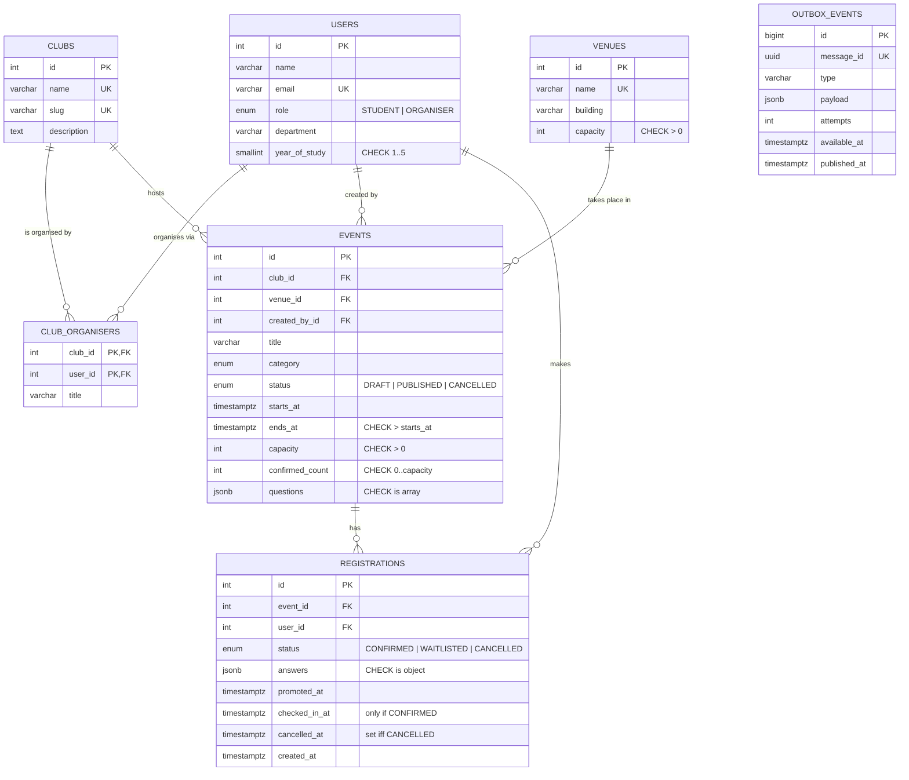

# Data model: PostgreSQL (source of truth) and MongoDB (derived views)

## ER diagram (PostgreSQL)

## Relationships

- **Club ↔ User (M:N).** A club has several organisers and a user can organise several clubs. The junction table `club_organisers` has a composite primary key `(club_id, user_id)`.
- **Club → Event (1:N), Venue → Event (1:N).** Both use `ON DELETE RESTRICT`, so a club or venue with history can't vanish.
- **Event → Registration (1:N), User → Registration (1:N).** Registrations use `ON DELETE CASCADE`, so they belong to their event.
- **Outbox (standalone).** Messages reference events and users only inside their JSON payload. The outbox is a delivery queue, not part of the business model.

## Normalisation (ADB M1.5)

- **1NF.** Every column holds one value. The two JSONB columns are deliberate exceptions for genuinely variable data:
  - `events.questions` is each event's own form definition.
  - `registrations.answers` holds a student's answers to it.

  Both are always read whole with their row, and nothing joins to them. The CHECK constraints still guarantee their top-level shape.
- **2NF.** Every table has a single-column surrogate key, except `club_organisers`. There, `title` depends on the whole `(club_id, user_id)` key.
- **3NF.** Venue facts (building, capacity) live in `venues`, not on every event, and club facts live in `clubs`. Without that, a venue's capacity copied onto 30 event rows could go out of sync (an update anomaly).
- **One controlled denormalisation.** `events.confirmed_count` duplicates `COUNT(registrations WHERE status = 'CONFIRMED')` because every catalogue card needs "seats left". It is safe for three reasons:
  1. It changes only inside the same transaction that changes a registration, while the event row is locked.
  2. A CHECK constraint stops it from ever exceeding capacity.
  3. An integrity probe (`countMismatches`, shown on `/health`) and tests DB-Q10 and BE-I20 prove it equals the real count.

## Constraints that encode business rules (ADB M1.6)

| Constraint | Rule |
|---|---|
| `events_confirmed_within_capacity_chk` | Never more confirmed seats than capacity. This is the database-level "no overbooking" guarantee. |
| `registrations_one_active_per_user_key` (partial UNIQUE, `WHERE status <> 'CANCELLED'`) | One active registration per student per event. Cancelled history is kept. |
| `registrations_cancelled_at_chk` | `cancelled_at` is set exactly when the status is CANCELLED. |
| `registrations_checkin_requires_confirmed_chk` | Only confirmed attendees can be checked in. |
| `events_time_order_chk`, `events_registration_closes_before_start_chk` | Time ranges make sense. |
| `events_published_at_chk` | Anything that isn't a draft has a publication time. |
| `events_questions_is_array_chk`, `registrations_answers_is_object_chk` | JSONB keeps its expected top-level shape. |

## Indexes and why each exists (ADB M1.9, M1.10, M1.15)

| Index | Type | Serves | Evidence |
|---|---|---|---|
| `events_published_starts_at_idx` on `(starts_at, id) WHERE status = 'PUBLISHED'` | Partial B-tree | Catalogue page and its cursor pagination (keyset on `starts_at, id`) | 439× faster (DB-I01, benchmark) |
| `events_published_category_starts_at_idx` on `(category, starts_at, id) WHERE status = 'PUBLISHED'` | Partial composite | Category filter when the category is rare | 3.8–4× faster (DB-I02). The planner correctly ignores it for common categories. |
| `registrations_answers_gin_idx` on `answers jsonb_path_ops` | GIN | Organiser filter `answers @> {...}` | 114× faster (DB-I03) |
| `registrations_event_id_status_created_at_idx` | Composite B-tree | Attendee page, waitlist order, "next waitlisted" | 476× faster with no sort step (DB-I04) |
| `registrations_user_id_created_at_idx` (`created_at DESC`) | Composite | "My passes", newest first | |
| `events_club_id_starts_at_idx` | Composite | Organiser dashboard (a club's events by date) | |
| `outbox_events_pending_idx` on `(available_at, id) WHERE published_at IS NULL` | Partial | Dispatcher's "what is due?" poll. Published rows are never indexed. | |

## MongoDB collections (ADB M3)

| Collection | Shape | Indexes | Validation |
|---|---|---|---|
| `notifications` | `{ outboxId, userId, type, title, message, data (varies by type), readAt, expiresAt, createdAt }` | `outboxId` unique (idempotent delivery); `{userId: 1, createdAt: -1}`; TTL on `expiresAt` | Mongoose validators and `pre('validate')` hook; `$jsonSchema` in MongoDB |
| `activity_logs` | `{ outboxId, action, actor {id, name}, event {id, title, clubId, clubName}, meta, at }` | `outboxId` unique; `{'event.id': 1, at: -1}`; `{'event.clubId': 1, at: -1}`; TTL 180 days on `at` | Mongoose validators; `$jsonSchema` |

**Embedding vs referencing (M3.8).** `actor` and `event` are embedded snapshots: they are small, always read with the activity, and must show history as it was. `userId` and the event ids are references back to PostgreSQL for anything that needs live data.

**Dual-write problem (M3.19).** Writing to PostgreSQL and MongoDB directly from the same request could leave them disagreeing if one write fails. SeatSure writes an outbox row inside the PostgreSQL transaction instead. A dispatcher then delivers it to MongoDB with retries and backoff, and each delivery carries an idempotency key (`outboxId` = `message_id` UUID). The result is that MongoDB may lag behind PostgreSQL, but it never loses or invents an event.
